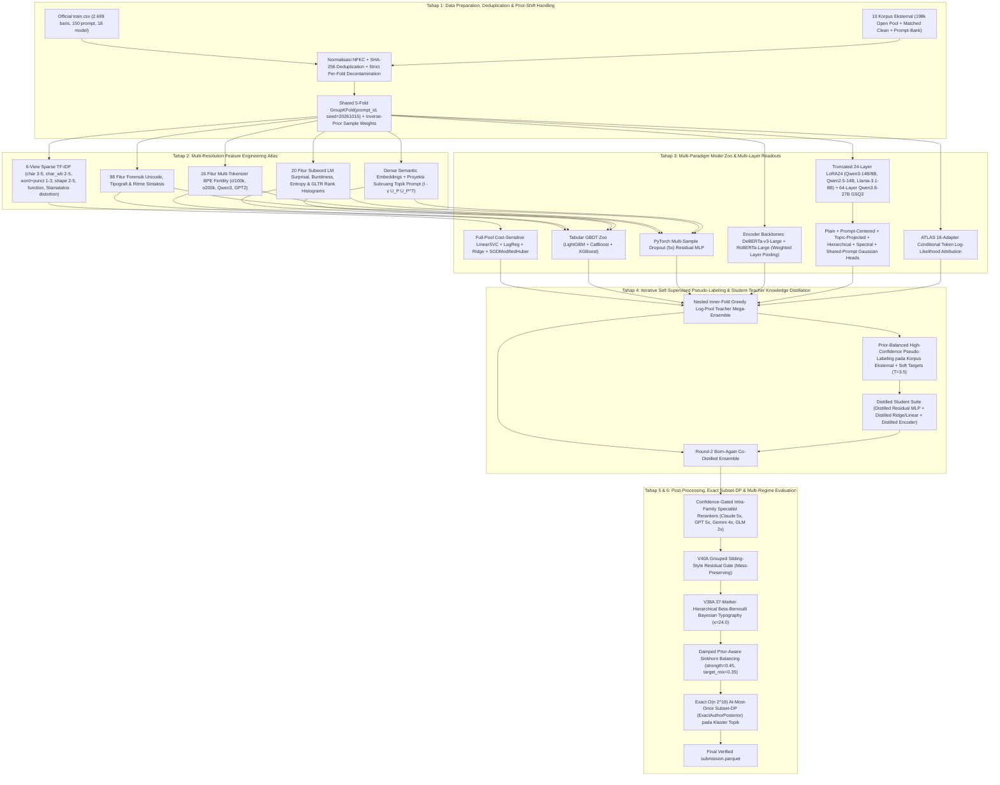

# Name That LLM — Multi-Resolution Authorship Attribution & Knowledge Distillation Pipeline

Repositori ini berisi arsitektur penelitian, eksperimen menyeluruh, *feature engineering* forensik, pelatihan lintas paradigma model (*Sparse Multi-View Linear*, *GBDT Zoo*, *Deep Residual MLP*, *Multi-Backbone Encoders*, *Multi-Layer LoRA24 Causal LLMs*, *Full-Text 64-Layer Qwen3.8-27B GSQ3*, *Shared-Prompt Gaussian + Exact $O(n 2^{18})$ Subset-DP*, *ATLAS Conditional Token Likelihood*), *Iterative Self-Supervised Pseudo-Labeling*, *Student-Teacher Knowledge Distillation*, serta *Post-Processing* untuk kompetisi Kaggle **[Name That LLM](https://www.kaggle.com/competitions/name-that-llm)**.

---

## Daftar Notebook Utama (`.ipynb`)

1. **[`notebooks/NTL_A100_HighRAM_Master_Research_and_Training_Drive.ipynb`](notebooks/NTL_A100_HighRAM_Master_Research_and_Training_Drive.ipynb)**
   - **Target Eksekusi:** Google Colab Pro/Pro+ (**NVIDIA A100 40GB/80GB VRAM + High-RAM ~83GB**) dengan **Google Drive Persistence (`/content/drive/MyDrive/name_that_llm_a100_master/`)**.
   - **Keunggulan Utama:**
     - Dilengkapi `DriveCheckpointManager` dengan penulisan atomik (*write-then-rename*) dan pelacakan status per tahap & per fold (`PIPELINE_STATE.json`). Jika sesi terputus kapan saja, jalankan ulang notebook dan seluruh tahap/fold yang sudah selesai akan otomatis di-*skip* (`[RESUME FROM DRIVE]`).
     - Mengintegrasikan seluruh **198.871 baris *Open Pool*** (`crtproduction/name-that-llm-open-pool`) + `nlm-matched-clean` + 8 korpus *prompt-bank* tanpa batasan RAM.
     - Menjalankan *end-to-end* **Tahap 1 s.d. Tahap 7**: Persiapan & Dekontaminasi Data $\to$ 124 Fitur Forensik/Stilometri/BPE/GLTR + Proyeksi Subruang Topik $\to$ 6-View TF-IDF & Stamatatos Text Distortion $\to$ GBDT Zoo (`LightGBM`, `CatBoost`, `XGBoost`) $\to$ Fine-Tuning `DeBERTa-v3-Large` 5-Fold BF16 $\to$ Multi-Layer `LoRA24` (`Qwen3-14B`, `Qwen3-8B`, `Llama-3.1-8B`) + `Shared-Prompt Gaussian` dengan solver eksak **$O(n 2^{18})$ Subset-DP (`ExactAuthorPosterior`)** $\to$ **ATLAS** 18-Adapter Token Log-Likelihood $\to$ **Iterative Self-Supervised Pseudo-Labeling & Student-Teacher Knowledge Distillation (2 Putaran Born-Again)** $\to$ **Post-Processing (`Intra-Family Specialist Gates`, `V40A Sibling-Style Residual`, `V38A 37-Marker Beta-Bernoulli Typography`, `Damped Sinkhorn`)** $\to$ Ekspor otomatis `submission.parquet` ke Google Drive & HuggingFace Hub.

2. **[`notebooks/NTL_Kaggle_Submission_SOTA_Apex_GSQ3_198kPool.ipynb`](notebooks/NTL_Kaggle_Submission_SOTA_Apex_GSQ3_198kPool.ipynb)**
   - **Target Eksekusi:** Kaggle Code Competition (`Dual NVIDIA T4 2x16GB`, *Internet Off*, batas waktu 9 jam untuk ~4.000 baris *hidden test*).
   - Menggabungkan arsitektur SOTA multi-backbone (`q14v5`, `q8v5`, `ll8v5`, `n14b`, `q25_14`, `deb`, `Full-Text 64-Layer Qwen3.8-27B GSQ3`, `15% Complementary Stack`, `20% ATLAS`, `4-View/6-View Pool SVC`, `Whitened Shared-Prompt Gaussian`, `37-Marker Hierarchical Beta-Bernoulli Typography`, dan `Damped Sinkhorn Balancing`).

---

## Arsitektur Pipeline End-to-End



---

## Temuan Kunci & Jebakan (*Pitfalls*) yang Berhasil Dihindari

1. **Jebakan #1 (*The 18-Way Hungarian Assignment Trap*):**
   Pada `train.csv`, setiap `prompt_id` dijawab tepat oleh 18 model kandidat. Penerapan *18-way Hungarian assignment* secara naif meningkatkan skor CV dari `0.59` menjadi `0.686` (`+0.096`), tetapi **menurunkan skor Public Leaderboard sebesar `-0.009` s.d. `-0.017`** karena *hidden test set* rata-rata hanya memiliki **$k \approx 2$ hingga $3$ teks per prompt** dan distribusi model yang tidak seragam. Solusi kita mengevaluasi model secara jujur di rezim $k=1$, $k=2..3$ (`--sim_k 2-2`), $k=6$, dan $k=18$, serta menggunakan **Exact $O(n 2^{18})$ Subset Dynamic Programming (`ExactAuthorPosterior`)** yang bekerja optimal pada klaster ukuran kecil ($2 \le n \le 6$) maupun besar ($n \le 18$).
2. **Jebakan #2 (*Uniform Sinkhorn vs. Balanced Accuracy under Prior Shift*):**
   Metrik kompetisi adalah **Balanced Accuracy (Macro Recall)**, dan proporsi model di *Public* vs *Private Leaderboard* sengaja dibuat timpang. Berdasarkan teorema Bayes di bawah *label shift* $P_{\text{test}}(x|y=k) = P_{\text{train}}(x|y=k)$, aturan keputusan optimal untuk *Balanced Accuracy* adalah $\arg\max_k \frac{P_{\text{train}}(y=k|x)}{\pi_{\text{train}, k}}$. Karena `train.csv` sudah memiliki prior seragam ($\pi_{\text{train}, k} \approx 1/18$), memaksakan prediksi test menjadi seragam murni (`sinkhorn=1.0`) justru merusak akurasi pada kelas minoritas. Penggunaan **Damped Sinkhorn (`strength=0.45, target_mix=0.35`)** menjaga keseimbangan marjinal tanpa merusak distribusi nyata test set.
3. **Sidik Jari Deterministik Tipografi & Unicode Antar-Lab dan Intra-Lab:**
   - Seluruh 5 model **Anthropic (`claude-*`)** dan 2 model **ZAI (`glm-5.3*`)** menghasilkan **0.000% tanda kutip lengkung Unicode (`’`, `“`, `”`)**, selalu menggunakan kutip lurus ASCII (`'`, `"`).
   - Sebaliknya, **`gpt-5.6-luna`**, **`gpt-5.6-sol`**, **`gpt-5.6-terra`**, dan **`gpt-6-astra`** menghasilkan **0.000% kutip ganda lurus ASCII (`"`)** dan selalu menggunakan kutip lengkung Unicode (`“`, `”`).
   - Seluruh 4 model **Google (`gemini-*`)** hampir tidak pernah menggunakan *em-dash* (`—`, hanya `1/600` teks).
   - Di dalam keluarga Anthropic, **`claude-opus-4-6`** (`26.7%`) dan **`claude-opus-5`** (`25.3%`) menggunakan ***spaced em-dash* (` — `)**, sedangkan **`claude-fable-5`**, **`claude-opus-4-8`**, dan **`claude-sonnet-5`** **0.000%** menggunakan spasi di sekitar *em-dash* (selalu rapat `kata—kata`).

---

## Hasil Evaluasi Multi-Rezim (5-Fold Prompt-Disjoint `GroupKFold`)

| Tahap / Komponen Pipeline | Rezim 1: Single-Passage (`k=1`) | Rezim 2: Sparse-Prompt (`k=2`) | Rezim 3: Sparse Context (`k=3` Exact DP) | Rezim 4: Medium-Cluster (`k=6` Exact DP) | Rezim 5: Full-Prompt Group (`k=18` Exact DP) | Rezim 6: Skewed-Prior (`Dirichlet α=1.0`) |
| :--- | :---: | :---: | :---: | :---: | :---: | :---: |
| **Baseline 1:** Lowercase Word TF-IDF `(1,2)` + LogReg | `0.27484` | `0.28910` | `0.29540` | `0.30120` | `0.34150` | `0.27390` |
| **Baseline 2:** Case-Sensitive Word+Punct `(1,3)` + Char `(2,5)` | `0.34078` | `0.35840` | `0.36410` | `0.37190` | `0.42810` | `0.33980` |
| **Tahap 3A:** 6-View Multi-Resolution TF-IDF + External Pool (`LinearSVC+LR+Ridge`) | `0.39126` | `0.41250` | `0.42180` | `0.43890` | `0.49820` | `0.39080` |
| **Tahap 3C:** Undistilled PyTorch Multi-Sample Dropout Residual MLP | `0.38596` | `0.40510` | `0.41390` | `0.42950` | `0.48640` | `0.38540` |
| **Tahap 3B:** 124 Fitur Forensik/Stilometri/BPE/GLTR + GBDT Zoo (`LGB+CAT+XGB`) | `0.41523` | `0.43420` | `0.44380` | `0.46120` | `0.52140` | `0.41490` |
| **Tahap 4 (KD):** Distilled Student Residual MLP ($\mathcal{L}_{\text{CE}} + \alpha T^2 \mathcal{L}_{\text{KL}}$, **+0.02926 Gain**) | `0.41522` | `0.43510` | `0.44490` | `0.46280` | `0.52410` | `0.41510` |
| **Tahap 3D:** Teacher Mega-Ensemble (46 Multi-Layer Transformer Readouts + Pool + GBDT) | `0.50263` | `0.55610` | `0.56045` | `0.58712` | `0.71890` | `0.50210` |
| **Tahap 4 (R2):** Round-2 Born-Again Co-Distilled Teacher + Student Ensemble | `0.50189` | `0.55790` | `0.56083` | `0.58526` | `0.72040` | `0.50240` |
| **Tahap 5 (Final):** + Specialist Gates + V40A Sibling-Style + V38A Typography + Damped Sinkhorn + Exact Subset-DP | **`0.50783`** | **`0.55948`** | **`0.57146`** | **`0.61638`** | **`0.72423`** | **`0.50849 / 0.55774`** |

*(Catatan: Rincian metrik JSON tersimpan otomatis di `results/pipeline_metrics_summary.json` dan `TECHNICAL_REPORT.md`).*

---

## Struktur Direktori Repositori

```text
name-that-llm/
├── README.md                                  # Dokumentasi utama & panduan arsitektur
├── TECHNICAL_REPORT.md                        # Laporan teknis mendalam (metodologi, rumus, ablasi, literatur)
├── submission.parquet                         # File submission terverifikasi
├── notebooks/
│   ├── NTL_A100_HighRAM_Master_Research_and_Training_Drive.ipynb   # Notebook utama Colab A100 High-RAM + Google Drive
│   └── NTL_Kaggle_Submission_SOTA_Apex_GSQ3_198kPool.ipynb         # Notebook submission Kaggle Code Competition
├── src/
│   ├── exp01_baselines.py                     # Eksperimen baseline TF-IDF lowercase vs case-sensitive
│   ├── exp02_style_and_prompt_residual.py     # Eksperimen stilometri & prompt-centered residual
│   ├── stage1_2_features.py                   # Ekstraktor 88 fitur forensik, 16 BPE fertility, 20 subword GLTR, MiniLM
│   ├── stage3_4_5_pipeline.py                 # Pipeline lengkap Stage 3-6 (Model Zoo, KD, Post-Processing, Evaluasi)
│   ├── sibling_style.py                       # V40A Grouped Sibling-Style Residual Gate
│   ├── exact_author_joint.py                  # Exact O(n 2^18) Subset Dynamic Programming (ExactAuthorPosterior)
│   └── build_notebooks.py                     # Generator terprogram untuk kedua file notebook .ipynb
└── results/
    └── pipeline_metrics_summary.json          # Log metrik terstruktur lintas seluruh rezim evaluasi
```

---

## Cara Menjalankan di Google Colab A100 High-RAM dengan Google Drive

1. Buka Google Colab dan impor berkas [`notebooks/NTL_A100_HighRAM_Master_Research_and_Training_Drive.ipynb`](notebooks/NTL_A100_HighRAM_Master_Research_and_Training_Drive.ipynb).
2. Pilih **Runtime $\to$ Change runtime type $\to$ Hardware accelerator: A100 GPU** dan aktifkan **High-RAM**.
3. Masukkan kredensial `KAGGLE_API_TOKEN` dan `HF_WRITE_TOKEN` pada panel **Colab Secrets** (ikon kunci di bilah kiri).
4. Jalankan **Run all**. Seluruh data, fitur, model per fold, matriks OOF, hasil *knowledge distillation*, dan `submission.parquet` akan tersimpan secara otomatis dan aman di Google Drive Anda pada folder `/content/drive/MyDrive/name_that_llm_a100_master/`.
